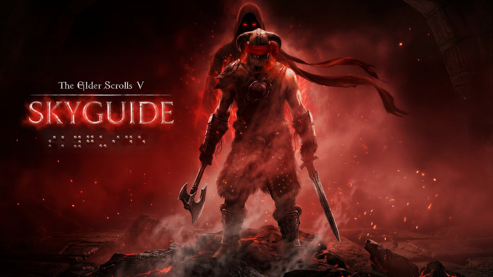

<p align="center">
  
</p>

# SkyGuide — Skyrim Accessibility Assistant

**SkyGuide** is a real-time accessibility assistant for blind and visually
impaired *Skyrim* players. A Skyrim Platform plugin streams game state, a
capture source streams short video clips, and a two-tier AI pipeline turns
them into spoken guidance — a **Gate** decides *whether* the player should
hear something right now, then a **Composer** phrases the observation in
French. Every broadcast carries provenance (which engine spoke, how long it
took).

One app, two surfaces:

- **Web dashboard** (`/`) — the operator/dev console: live session,
  provenance chips, engine pickers, eval matrix (`/evals`)
- **Electron player runtime** (`pnpm dev:player` / `pnpm package:player`) —
  the blind player's shell: hidden window, tray + autostart, global
  push-to-talk (F9), capture auto-targeting the Skyrim window, direct audio
  out

## How it works

1. A **capture source** — browser `getDisplayMedia()`, the Electron
   auto-matched Skyrim window, or a video file in Sim mode — is encoded into
   short clips with [MediaBunny](https://mediabunny.dev/) (in-browser via
   WebCodecs, no FFmpeg).
2. Clips are sent to the **Nitro server** over WebSocket (`/_ws`).
3. The **Gate** (`server/utils/gate.ts`) decides *whether* to speak:
   engines `gemini` (decision-only), `local` (OpenAI-compatible), or
   `rules` (0 ms canned callouts, clip-blind). A novelty filter prevents
   repeats.
4. When the gate says speak, the **Composer**
   (`server/packages/composer/`) phrases the observation in French:
   `gemini-cloud` or a self-hosted vision model. Unknown/hallucinated
   action suggestions are filtered downstream.
5. The observation goes through the **voice module**
   (`server/packages/voice/`) — TTS and STT engines with per-platform
   fallback chains and probes (Mistral, ElevenLabs, Piper, Google, Edge,
   macOS `say`; Whisper/Parakeet locally).
6. Suggested **actions** are broadcast to the dashboard *and* queued in an
   outbox (`GET /api/actions?since=<id>`) that the
   [SKSE plugin](https://github.com/bertyn99/skyguide-skse) polls and
   executes in-game.

```
Capture source                  Server (Nitro, :3000)
┌─────────────────┐      ┌────────────────────────────┐
│ getDisplayMedia  │      │ Gate (shouldSpeak? engine)  │
│ → MediaBunny    │─WS──▶│ → Composer (French prose)   │
│   (MP4 encode)  │      │ → voice module TTS chain    │
│                 │◀─WS──│   (Mistral/ElevenLabs/Piper)│
│ audio queue     │      │   provenance on everything  │
└─────────────────┘      └────────────────────────────┘
        ▲                            ▲
        │ game state + /api/actions  │ mod context (file dump)
        └──────── SKSE plugin ───────┘
```

The game side lives in
[skyguide-skse](https://github.com/bertyn99/skyguide-skse): a TypeScript
Skyrim Platform plugin that POSTs structured game state (protocol v1),
polls `/api/actions?since=<id>` for at-most-once action delivery, and dumps
mod context to `Data/Platform/SkyGuide/state.json` for the file connector
the Gate and Composer read.

## Getting started

Prerequisites: **Node.js** (via [fnm](https://github.com/Schniz/fnm)) and
**pnpm**; a Chromium-based browser for the dashboard (WebCodecs). Cloud
engines need API keys in `.env` — see [Configuration](#configuration); the
offline engines (Piper, Whisper, local composer) are optional and show
setup hints in the dashboard when missing.

```bash
pnpm install
pnpm dev                # operator dashboard on :3000
```

Then pick a source in the dashboard: **Screen** (browser capture picker) or
**video file** (Sim mode), and **Start capture**.

### Sim mode (lets-plays)

Run the whole pipeline against a video file instead of the live game.
Download source videos into the gitignored `media/letsplays/` folder — pure
npm, no external tools (`@distube/ytdl-core` downloads, mediabunny slices):

```bash
pnpm fetch:letsplays                     # curated Skyrim playthroughs
pnpm fetch:letsplays --list              # see what's in the curated list
pnpm fetch:letsplays --playlist <id|url> --list          # enumerate a playlist
pnpm fetch:letsplays --playlist <id|url> --max 3 --section 12:00-14:00
pnpm fetch:letsplays --search "query"    # search YouTube (top 3)
pnpm fetch:letsplays --id <url|id> --section 12:00-14:00   # grab a slice
```

French source material: Bob Lennon's *L'Intégrale Skyrim* (200 FR-commentary
episodes, ~15 min each) works well for evals —
`pnpm fetch:letsplays --playlist PL89A711C53A33F2E4 --list`.

Downloads are large (multi-hour videos), which is why `media/` is gitignored —
the script is the reproducible path on a fresh machine. Quality defaults to
1080p: YouTube serves 1080p as separate video/audio streams, which the script
merges in-process with mediabunny (no ffmpeg).

### Player runtime (Electron)

```bash
pnpm dev:player        # dev shell against the dev server (window visible)
pnpm build:player      # client + nitro (.output) + electron main/preload (dist-electron)
pnpm package:player    # NSIS installer (Windows x64) in release/
```

The shell runs `/player` — the same session core with no operator UI. F9
toggles the mic (`SKYGUIDE_PTT_KEY` to change), capture auto-targets the
`/skyrim/i` window, autostart is a tray checkbox.

### Engine seams

Every seam has cloud and local engines with fallback chains and
availability probes; the dashboard shows readiness and setup hints. The
**Offline profile** button flips every seam locally at once (gated
pipeline, local gate/composer, Piper TTS, Whisper STT); **Cloud** restores
the baseline.

| Seam | Cloud | Local / offline |
|------|-------|-----------------|
| Gate | Gemini (decision-only) | OpenAI-compatible endpoint, reflex rules |
| Composer | Gemini (compose-only) | self-hosted vision model (Ollama/LM Studio/vLLM) |
| TTS | ElevenLabs, Mistral, Google, Edge | Piper (voipi auto-install), macOS `say` |
| STT | ElevenLabs | Whisper (sidecar, pinned models), Parakeet CLI |

## Configuration

Engine selection lives in the dashboard (persisted via WS commands); env
vars set the defaults:

| Env | Default | Description |
|-----|---------|-------------|
| `GOOGLE_GENERATIVE_AI_API_KEY` | — | Gemini (fused pipeline, gate, cloud composer) |
| `ELEVENLABS_API_KEY` | — | ElevenLabs TTS/STT |
| `MISTRAL_API_KEY` | — | Mistral Voxtral TTS |
| `COMPOSER_LOCAL_BASE_URL` | `http://127.0.0.1:11434/v1` | self-hosted composer endpoint |
| `COMPOSER_LOCAL_MODEL` | `qwen2.5vl:7b` | vision model id |
| `SKYGUIDE_PORT` | `3000` | Nitro/sidecar port (Electron) |
| `SKYGUIDE_PTT_KEY` | `F9` | global push-to-talk accelerator |
| `WHISPER_STT_LANGUAGE` | `fr` | listening language |
| `SKYRIM_CONTEXT_FILE_PATH` | `./src/assets/state.json` | Absolute path to the SKSE plugin dump (`Data/Platform/SkyGuide/state.json`). Gate + Composer read this; without it they never see live mod context. |

Local Whisper models install from the dashboard (`pnpm setup:whisper`
bootstraps the toolchain).

## Development

```bash
pnpm test          # Vitest + nitro-test-utils (unit + integration)
pnpm test:watch
pnpm lint          # ESLint (typescript-eslint + eslint-plugin-vue)
pnpm build         # vue-tsc -b + vite build
```

`pnpm build:player` adds the Electron shell (dist-electron) — plain dev and
build never touch Electron.

## Project structure

```
src/                        # Vue 3 dashboard (Pinia, Nuxt UI v4, TanStack Query)
  views/                    #   SessionView, EvalsView (operator), PlayerView (Electron)
  stores/session.ts         #   session state + WS client
  utils/                    #   capture (MediaBunny), voice, ws-binary, electron-bridge

electron/                   # Stage 7 player runtime (--mode player only)
  main.ts                   #   sidecar lifecycle, tray, autostart, /skyrim/i
                            #   capture auto-source, global push-to-talk
  preload.ts                #   contextBridge → window.skyguide

server/                     # Nitro server (WS + API)
  routes/_ws.ts             #   WebSocket handler
  packages/voice/           #   TTS/STT seam (registry + fallback chains)
  packages/composer/        #   Composer seam (registry + fallback chain)
  utils/engine.ts           #   pipelines (fused/gated), reflex, profiles
  utils/gate.ts             #   System 1 decision model
  utils/action-outbox.ts    #   SKSE action delivery

test/                       # Vitest + nitro-test-utils
situations/                 # Eval fixtures + matrix results
docs/adr/                   # Architecture decision records
```

## Documentation

- [`LIFT-PLAN.md`](LIFT-PLAN.md) — stage-by-stage roadmap with verification state
- [`GLOSSARY.md`](GLOSSARY.md) — domain vocabulary (Gate, Composer, Seam, SILENCE…)
- [`docs/adr/`](docs/adr/) — decision records
- Companion plugin: [skyguide-skse](https://github.com/bertyn99/skyguide-skse)

## License

Private.
